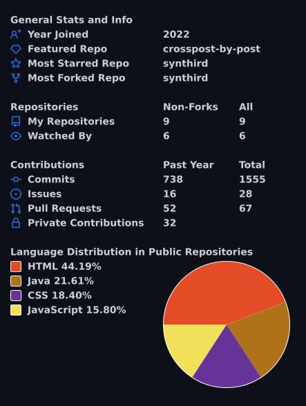

## ```<greeting>```Hi there!```</greeting>```

I've been programming since mid 2020. 🕛

<details>
  <summary>:octocat: GitHub activity card (Doesn't indicate proficiency)</summary> <br>

  [](https://github.com/cicirello/user-statistician)
</details>


<!--
**Synthird/Synthird** is a ✨ _special_ ✨ repository because its `README.md` (this file) appears on your GitHub profile.

Here are some ideas to get you started:

- 🔭 I’m currently working on ...
- 🌱 I’m currently learning ...
- 👯 I’m looking to collaborate on ...
- 🤔 I’m looking for help with ...
- 💬 Ask me about ...
- 📫 How to reach me: ...
- 😄 Pronouns: ...
- ⚡ Fun fact: ...
-->
